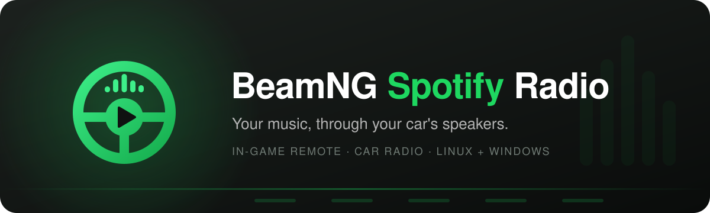
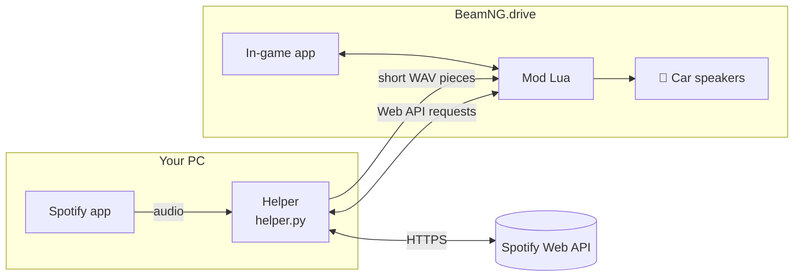

<p align="center">
  
</p>

<p align="center">
  
  
  
  
</p>

<p align="center">
  Control Spotify without leaving the driver's seat, and hear it <b>through your car's speakers</b>,<br>
  muffled from outside, full stereo in the cabin, quiet when the engine is off.
</p>

---

## ✨ Features

| | |
| --- | --- |
| 🎛️ **In-game remote** | Current track, cover art and progress; play/pause, next and previous |
| 🏠 **Home view** | The grid button opens a big Spotify-style start page: recently played, your playlists, liked songs, top songs and artists, saved albums and search. Pick something, press the grid button again, and you're back to the small player |
| 🚗 **Car radio** | Spotify plays *from the car*: it fills the cabin when you sit inside, and comes from the vehicle when the camera is outside |
| 🔊 **Car speaker EQ** | Optional filter that makes the music sound like small car speakers instead of headphones |
| 🔑 **Ignition aware** | Pauses Spotify when the ignition is off, when you walk, or when the game is paused, and resumes afterwards |
| 🎮 **Bindable controls** | Play/pause, next, previous and show/hide on keys or steering-wheel buttons |
| 📈 **Up to 200 % volume** | Boost quiet tracks above 100 %, with a soft limiter instead of distortion |
| 🐧 🪟 **Linux & Windows** | Native Linux build (PipeWire / PulseAudio) and Windows 10 1803+ |

## 🧩 How it works

BeamNG's UI is not allowed to reach the internet, open a browser or capture other programs' audio. A small **helper** on your PC does those three things, and the **mod** handles everything inside the game.



- **Audio:** the helper takes Spotify's sound away from your speakers, applies the optional EQ and writes it into BeamNG's temp folder in 0.5 s pieces. The mod plays them back seamlessly through the game's sound engine.
  - Linux: through a private PipeWire/PulseAudio sink.
  - Windows: through VB-CABLE.
- **Remote:** the in-game app's Spotify Web API requests and cover images are passed through the helper.
- **When the radio is off or the game is closed**, Spotify plays through your speakers as usual.

## 📦 Requirements

- Spotify desktop app and **Spotify Premium** (Spotify only allows playback control for Premium accounts)
- Python 3.9+ with `numpy`, and `ffmpeg`
- **Linux:** `pactl` (PipeWire or PulseAudio), `playerctl`, and `wl-copy` or `xclip`
- **Windows:** [VB-CABLE](https://vb-audio.com/Cable/) (free virtual audio cable). The install script takes care of the rest.

## 🚀 Setup

### 1. Install the mod

Download `spotifyremote_davidx3d.zip` from the [latest release](https://github.com/david-x3d/BeamNG-Spotify-Radio/releases/latest), or build it from this repository:

```bash
python3 tools/build_mod.py
```

Copy `dist/spotifyremote_davidx3d.zip` into BeamNG's mods folder:

| OS | Mods folder |
| --- | --- |
| Linux | `~/.local/share/BeamNG/BeamNG.drive/current/mods/` |
| Windows | `%LOCALAPPDATA%\BeamNG\BeamNG.drive\current\mods\` |

> [!TIP]
> For development, link the `mod` folder as `mods/unpacked/spotifyremote_davidx3d` instead. Changes then apply with a Lua reload.

### 2. Install the helper

<details open>
<summary><b>🐧 Linux</b></summary>

<br>

This installs a systemd user service that starts with your session:

```bash
./helper/install-linux.sh
```

To follow the log:

```bash
journalctl --user -u spotifyremote-radio -f
```

</details>

<details>
<summary><b>🪟 Windows</b></summary>

<br>

1. Install [VB-CABLE](https://vb-audio.com/Cable/). Run the installer as administrator, then reboot.
2. Install [Python](https://www.python.org/) and tick **"Add python.exe to PATH"**.
3. Run in PowerShell:

   ```powershell
   powershell -ExecutionPolicy Bypass -File helper\install-windows.ps1
   ```

The script:
- installs the Python packages and ffmpeg;
- downloads NirSoft `svcl.exe`, which switches Spotify's output device;
- starts the helper, and adds it to Windows startup.

The log is written to `helper\helper.log`.

</details>

### 3. Create a Spotify app

1. Open the [Spotify developer dashboard](https://developer.spotify.com/dashboard) and click **Create app**.
2. Add this Redirect URI and tick **Web API**:
   ```
   http://127.0.0.1:8899/callback
   ```
3. Copy the app's **Client ID**.

### 4. Connect in the game

1. Add **Spotify Remote** to your UI layout (UI apps → General).
2. Paste the Client ID and click **Connect with Spotify**.
3. Log in to Spotify in the browser window that opens. That's it.

Key bindings are under **Options → Controls → General** (`Spotify: …`).

> [!NOTE]
> Connected before the home view existed? Open it with the grid button and click **Reconnect Spotify** once. The home view needs permission to read your playlists and library. Also update the helper, it now loads playlist covers too.

### Browse your music

Press the grid button in the small player to open the home view. Browse recently played music, playlists, liked songs, top tracks and artists, or saved albums, and use search to find more music. Open a tile to browse its songs or start playback.

Press the grid button again to return to the small player. The home view also closes automatically when a game menu opens or the UI apps are hidden.

When updating an existing installation, replace the mod ZIP and update the helper from the same release's source archive, then restart the helper and reload BeamNG. For an unpacked development installation, press **Ctrl+L** to reload the Lua changes.

## ⚙️ Settings

The settings are behind the gear icon in the app:

| Setting | What it does |
| --- | --- |
| Car radio | Play Spotify through the car instead of your PC speakers |
| Volume | 0–200 %. Above 100 %, the helper boosts the audio with a soft limiter |
| Volume outside the car | How loud the radio is when the camera is outside |
| Car speaker sound (EQ) | Less sub bass, slightly boxy mids, narrower stereo |
| Pause with ignition off / on foot | Pauses Spotify when the engine is off or you walk |
| Pause when the game is paused | Pauses Spotify while the game is paused |

## 🛠️ Troubleshooting

<details>
<summary><b>"No connection. Is the helper running?"</b></summary>

<br>

The in-game app can't reach the helper. Start it:
- Linux: `systemctl --user restart spotifyremote-radio`
- Windows: run `install-windows.ps1` again, or start `pythonw helper\helper.py`

</details>

<details>
<summary><b>"Waiting for sound"</b></summary>

<br>

Spotify isn't playing, or the helper can't capture it. Check the helper log.

On Windows, also make sure VB-CABLE is installed and `svcl.exe` is next to `helper.py`.

</details>

<details>
<summary><b>Nothing opens when I click "Connect with Spotify"</b></summary>

<br>

Click **"Nothing opened? Copy the link"** and paste the link into your browser.

</details>

<details>
<summary><b>A playlist opens without songs</b></summary>

<br>

Spotify only lets apps list the songs of playlists you own or collaborate on. Press the play button to play the whole playlist anyway.

</details>

<details>
<summary><b>Windows: Spotify is silent after a crash</b></summary>

<br>

The helper normally switches Spotify back to your speakers. If it couldn't, do one of the following:
- run `svcl.exe /SetAppDefault DefaultRenderDevice all Spotify.exe`;
- set Spotify back to **Default** under Settings → System → Sound → Volume mixer.

</details>

<details>
<summary><b>The car radio is a bit behind Spotify</b></summary>

<br>

That's expected. Passing the audio through the game's sound engine costs about one second.

</details>

## 🗂️ Project layout

```
mod/                 BeamNG mod (zip its contents)
├─ ui/…/SpotifyRemote/   in-game app (AngularJS directive)
├─ lua/…/spotifyRemote/  main.lua (login, settings, request relay)
│                        radio.lua (playback through the car)
└─ scripts/…             mod entry point
helper/              helper.py + install scripts for Linux and Windows
tools/build_mod.py   builds dist/spotifyremote_davidx3d.zip
tests/test_app.js    tests for the in-game app
```

Run the tests with:

```bash
node tests/test_app.js mod/ui/modules/apps/SpotifyRemote/app.js
```

---

<p align="center">
  <br>
  <sub>Not affiliated with Spotify or BeamNG GmbH.</sub>
</p>
